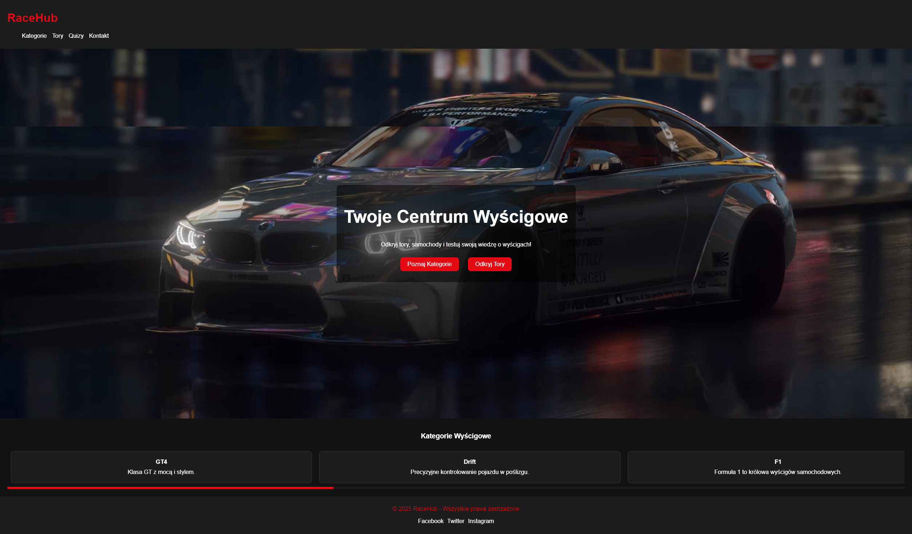

# 🏁 RaceHub - Twoje centrum świata wyścigów!  

RaceHub to strona internetowa poświęcona motoryzacji i wyścigom, oferująca:  
✅ Informacje o torach i samochodach  
✅ Kategorie wyścigowe: F1, GT, Drift, Drag, Rally i inne  
✅ Quizy testujące wiedzę o torach i motorsporcie  
✅ Rankingi kierowców i najlepszych czasów  

---

## 📸 Podgląd strony


---

## 🚀 Funkcje
🔹 Kategorie wyścigowe (GT1, GT2, GT3, GT4, Drift, Rally, F1, Drag)  
🔹 Dynamiczne karty kategorii (przesuwanie, responsywność)  
🔹 Moduł quizów o torach, autach i motorsporcie  
🔹 Baza wiedzy o autach i torach  
🔹 Nowoczesny design i ciemny motyw  

---

## 📂 Struktura projektu
```
RaceHub/
│── assets/              # Folder z obrazami i ikonami
│── styles/              # Pliki CSS
│   ├── main.css         # Główny plik stylów
│── js/                  # Skrypty JavaScript
│   ├── script.js        # Główne funkcje interaktywne
│── categories/          # Kategorie wyścigowe
│   ├── ...              # Strony kategorii
│── tracks/              # Tory wyścigowe
│   ├── ...              # Strony torów
│── index.html           # Strona główna
│── categories.html      # Kategorie wyścigowe
│── tracks.html          # Tory wyścigowe
│── quiz.html            # Strona quizów
│── about.html           # O stronie
│── README.md            # Dokumentacja projektu
```

---

## 🌐 Technologie
Projekt został stworzony przy użyciu:
- HTML5 + CSS3 (nowoczesny, responsywny design)
- JavaScript (interaktywność)

---

## 📥 Instalacja
Aby uruchomić RaceHub lokalnie:
1. Sklonuj repozytorium  
   ```bash
   git clone https://github.com/GrygielSzymon/RaceHub.git
   ```
2. Otwórz plik index.html w przeglądarce.  
3. Gotowe 🎉

---

## 🎮 Plany rozwoju
🔹 Dodanie panelu użytkownika i systemu logowania  
🔹 Zaawansowany ranking najlepszych wyników quizów  
🔹 Integracja z API (np. live wyniki F1)  

---

## 💡 Autor
👤 Szymon Grygiel  
📧 szymongrygiel11@gmail.com  

Jeśli podoba Ci się projekt, zostaw ⭐ star na GitHubie! 🚀  

